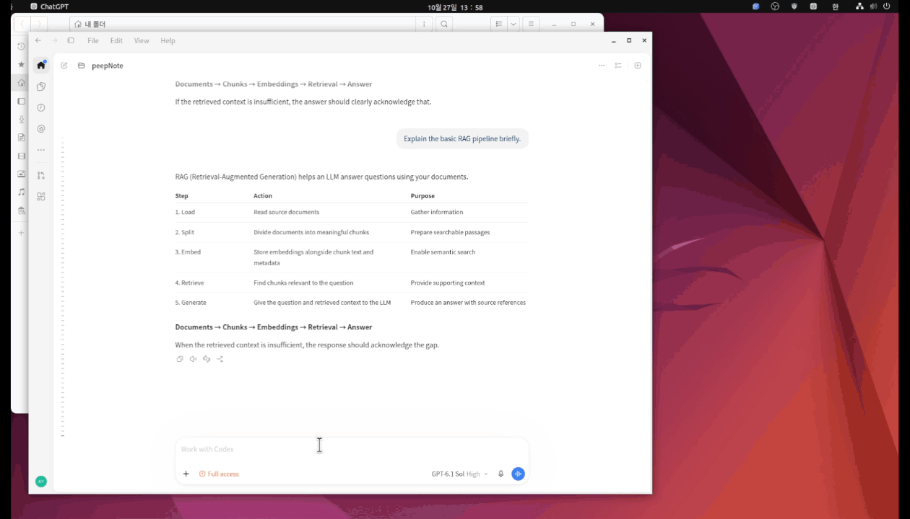
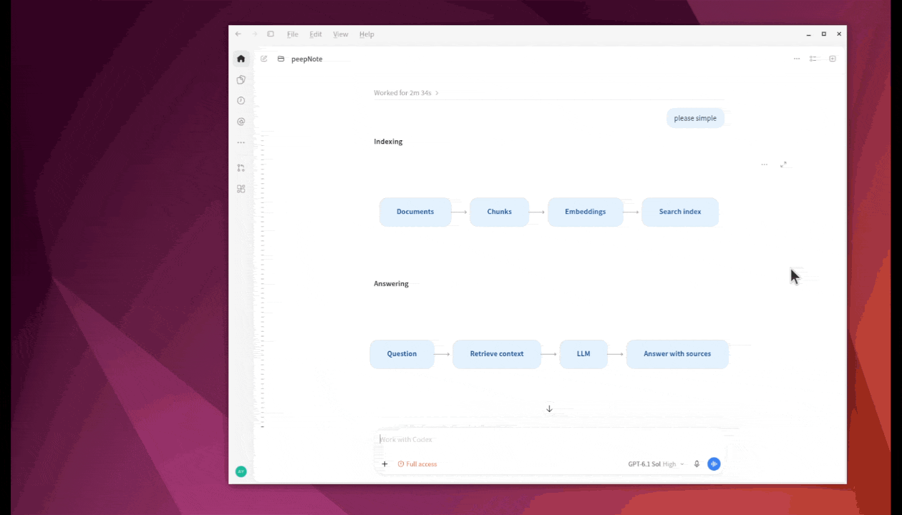
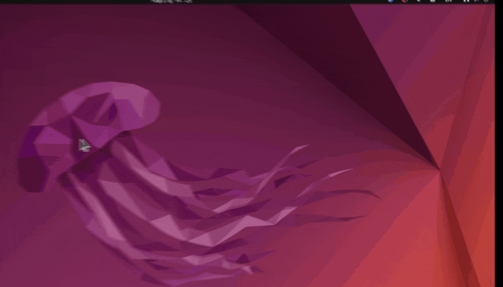
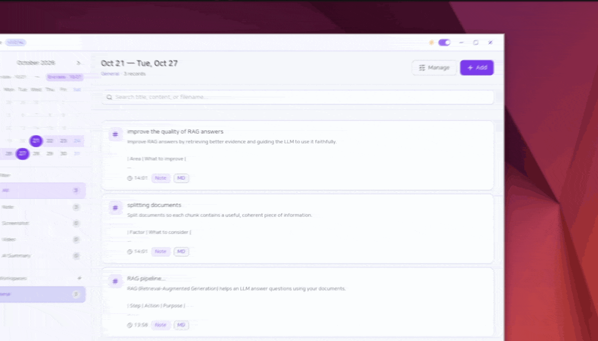
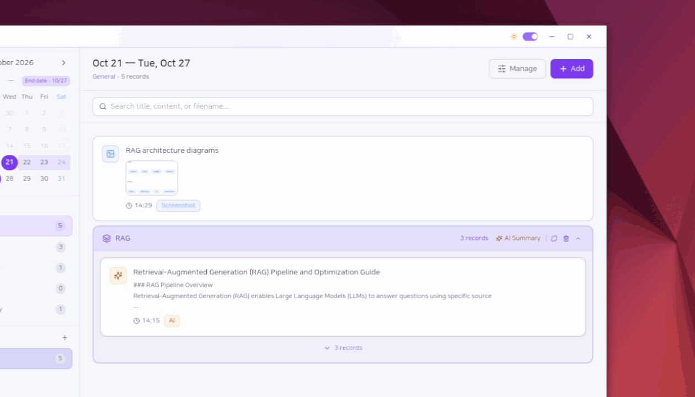

# PeepNote

PeepNote is a local-first desktop app for saving useful LLM responses, recording your own thoughts, and finding them again while you work. Keep Markdown answers and screenshots together, recall them with a shortcut, and organize related records into AI summaries.

> PeepNote keeps its application data on the local computer. AI summaries are optional and require an API key configured by the user.

## News

- **2026-10-28** — Added manual data folder selection in **Settings → App information → Data location → Change folder**. Choose an empty folder and restart to copy your notes, attachments, and settings there. Original files are kept as a backup. Thanks for the suggestion in [#1](https://github.com/OddlyGoods/peep-note/issues/1)!

## See it in action

### 1. Save LLM responses as Markdown notes

Keep the answers worth revisiting without searching through a long conversation. Copy an LLM response, press `Alt+1`, choose **Markdown**, and paste it into a note. Save with `Ctrl+Enter`, then open the note to review its headings, tables, and code blocks.



### 2. Capture diagrams and screenshots

Save the visual parts of an answer alongside your notes. Press `Alt+2`, drag to select a screen region, and capture a diagram, code example, or reference image. Open the saved screenshot to inspect the details.



### 3. Recall notes with Quick List

Bring saved answers back into your workflow without searching through the main window. Press `Alt+Q` to open Quick List and move to the next item; use `Alt+E` to go back. Open an item when you need its full content. Quick List uses the currently selected date range.



### 4. Turn related notes into an AI summary

Bring answers from multiple LLM conversations together. Use **Manage** to select related records, create a group, and click **AI Summary** to organize the material into one structured note. Summaries follow your selected app language and use the provider and API key configured in **Settings → AI settings**.



### 5. Keep note previews private with Secret

Enable **Secret** when creating a note to hide its content in list previews. Opening the saved note prompts for your four-digit PIN before showing its contents. Set your PIN in **Settings → Secret note lock**.



## Configuration

PeepNote opens directly to the main screen. There are no app accounts, login forms, Google sign-in, session tokens or authentication server. All windows use one local data space for notes, workspaces, settings and optional AI keys. OS user accounts still have their own application data directories.

The optional `VITE_LOCAL_SERVER_PORT` setting in `.env.example` defaults to `3848`, separate from the original PeepNote app. It is read at build time. The API listens only on `127.0.0.1` and rejects unrelated browser origins and hosts. No API key is bundled: enter your own provider key in Settings only if you use AI summaries.

The package and Linux executable are named `peep-note`. The app keeps its existing `open-peep-note` data directory and internal application ID so installed copies continue to read the same notes and settings after updates.

## Features

- Create text, Markdown, code, and HTML notes
- Capture a selected screen region and record a selected screen region
- Select and remember a preferred monitor for capture and recording
- Organize records with workspaces, tags, date ranges, search, and groups
- Restore deleted records from Trash during a configurable retention period (7, 10, 30, or 90 days; default 10), or permanently delete them
- Search Korean and English text in screenshots and attached images using local OCR
- Generate AI summaries with OpenAI, Claude, Gemini, or Qwen
- Use global shortcuts and a recent-record Quick List
- Protect secret notes with a four-digit PIN and masked list previews
- English, Korean, Japanese, and Simplified Chinese UI
- Light and dark themes

## Requirements

### Development environment

- Node.js 20 or newer
- npm 10 or newer
- Windows 10/11 or a current Linux distribution
- Build installers on the target operating system when possible: Windows for `.exe`, Linux for `.deb`

For Ubuntu 22.04 or newer, install Electron runtime dependencies:

```bash
sudo apt update
sudo apt install -y build-essential libnss3 libatk1.0-0 libatk-bridge2.0-0 \
  libcups2 libdrm2 libgtk-3-0 libgbm1 libasound2t64 libxss1 \
  xdg-utils xdg-desktop-portal xdg-desktop-portal-gtk
```

On Ubuntu 22.04, the audio package can be named `libasound2` instead of `libasound2t64`.

Wayland screen capture relies on PipeWire and an xdg-desktop-portal implementation for your desktop environment. Some Wayland compositors restrict global shortcuts; an Xorg session is the fallback if a shortcut cannot be registered.

## Install and run

### Development

```bash
git clone https://github.com/OddlyGoods/peep-note.git
cd peep-note
npm ci
npm run dev
```

Stop the development process with `Ctrl+C`. If the app remains in the system tray, use **Quit** from the tray menu to terminate the Electron process completely.

### Linux package

Build a Debian package:

```bash
npm run build:linux
```

The package is written to `release/`:

```bash
sudo apt install ./release/PeepNote-*-linux-amd64.deb
```

To produce an unpacked build for a quick smoke test:

```bash
npm run build:linux:dir
./release/linux-unpacked/peep-note
```

To update an existing PeepNote installation manually, install a newer `.deb` with the same command. Existing local records and settings are preserved.

### Windows package

Build the Windows installer on Windows:

```powershell
npm run build:win
```

The NSIS installer is written to `release/`. Run the generated `PeepNote-*-Setup.exe` and choose the normal install flow. Running the installer again updates an existing installation while preserving local records and settings.

Windows supports the same core features as Linux, including notes, local storage, comments, themes, AI summaries, capture, recording, tray controls, and global shortcuts. Capture behavior, multi-monitor DPI scaling, and shortcut availability should still be smoke-tested on the target Windows setup.

## Build commands

| Command | Purpose |
| --- | --- |
| `npm run dev` | Run the development Electron app with Vite. |
| `npm run build` | Build using electron-builder's default target. |
| `npm run build:linux` | Build the Linux x64 Debian package. |
| `npm run build:linux:dir` | Build an unpacked Linux x64 app in `release/linux-unpacked/`. |
| `npm run build:win` | Build the Windows NSIS installer. |
| `npm run release` | Create a release build and publish through the configured electron-builder provider. |
| `npm run test:updates` | Test update state, retries, renderer recovery, installation and release validation without installing anything. |
| `npm run verify:release` | Check the package/lockfile version and optional `RELEASE_TAG`. |

## App updates

Installed Windows and Ubuntu `.deb` builds check for updates automatically. To check manually, go to **Settings → App information → App updates → Check for updates**.

Choose **Download**, then **Restart and install** when you are ready. Ubuntu may ask for administrator authentication. Notes, attachments, and settings are preserved. Development and unpacked builds do not support in-app updates.

## Usage guide

### Trash

**Trash** is in the left navigation, below **Favorites**. Deleting a record, selected records, or a group moves its records to Trash and removes them from normal lists, search, Quick List, and calendar counts. Select records to restore them or permanently delete them. **Empty** permanently deletes all of the current user's trashed records after confirmation.

Records, comments, and managed media files are retained for the period selected in Settings → General → Trash retention: 7, 10, 30, or 90 days (default 10). This applies from the original deletion date, including records already in Trash. Expired records are removed at startup and periodically while the app runs. Restoring preserves group membership where the group still exists; records whose workspace was removed return to General. Media still referenced by another record is preserved when purging. Records deleted before this feature was installed cannot be recovered.

### Image text search

Open an image record and click **Extract text** to recognize its screenshot or attached images. Saving, opening, editing, restoring records, and launching the app never start extraction automatically. Interrupted requests must be started again. Korean and English recognition models ship with the app; OCR runs locally without an AI API key or uploading images. The first extraction prepares local models under the app's data directory. Extraction may take time for large images. Images larger than 40 MB are skipped; recognition accuracy depends on image quality and typography.

Use **Search** to find previously extracted image text alongside titles and note contents. Date, type, and workspace filters apply before pagination. Image details show extracted text and a Delete action that removes only the extracted text from the record and search. The original image is kept. After deleting the text, Extract text becomes available again. Secret records are excluded from OCR and content search. Making a record secret clears previously indexed image text.

### Feature regression tests

Run `npm run test:features` to check trash retention, restore, local profile isolation, media cleanup, search pagination, and real Korean/English OCR. Tests use a temporary database and image fixture; they do not access your records or build an installer.

### Create a record

1. Click **Add**, or open the quick composer with `Alt+1`.
2. Choose **Note**, **Screenshot**, or **Video**.
3. For notes, choose Text, Markdown, Code, or HTML.
4. Add an optional title, content, tags, and workspace, then save.

For screenshots and recordings, choose a region after selecting the capture action. Use the adjustment button next to the capture/record control in the main composer to choose a different monitor; PeepNote remembers the selected monitor for later captures.

### Default global shortcuts

| Shortcut | Action |
| --- | --- |
| `Alt+\`` | Open or hide the main window |
| `Alt+1` | Open the quick composer |
| `Alt+2` | Capture a screenshot region |
| `Alt+3` | Start screen recording |
| `Alt+4` | Stop screen recording |
| `Alt+Q` | Open the Quick List / move to the next item while it is open |
| `Alt+E` | Move to the previous Quick List item |

Shortcuts can be changed in **Settings → Global shortcuts**.

### Secret notes

Enable the **Secret** badge while creating or editing a note to mask its preview in lists. Set a four-digit secret PIN in **Settings → Secret note lock**. Opening a secret note requests the PIN; after a successful entry, secret notes remain unlocked for one minute in the current app session.

The PIN is stored as a hash, not plain text. A four-digit PIN is a convenience lock, not full-disk encryption; use operating-system account protection for highly sensitive data.

### AI summaries

1. Open **Settings → AI settings**.
2. Select a provider and model, then enter your API key.
3. Create a group from selected records and press **AI Summary**.

Summary titles and content use the app language selected in Settings, regardless of the language of the original records. Code, commands, URLs, and identifiers retain their original form.

Secret note content is excluded from AI summaries. Video files are not uploaded for summaries; only relevant written record content is used.

## Data and privacy

Notes, attachments, and settings are stored on your computer. AI summaries are optional; using them sends the selected non-secret written content to the provider configured in Settings with your own API key. Image text extraction runs locally.

Application data is stored locally. Typical locations are:

```text
Linux:   ~/.config/open-peep-note
Windows: %APPDATA%/open-peep-note
```

The legacy directory name is retained for compatibility. It contains the local database, screenshots, recordings, and application settings. Back up this directory before reinstalling the operating system or moving to another computer.

To choose a different data folder, open **Settings → App information → Data location → Change folder**. Select an empty folder, save any unfinished notes and settings, then confirm **Copy and restart**. PeepNote copies your records, managed media, OCR models, and settings and updates stored attachment paths before opening the new location. Original files are kept as a backup. Keep the selected drive available whenever you use the app.

## License

PeepNote is released under the [Apache License 2.0](LICENSE).
